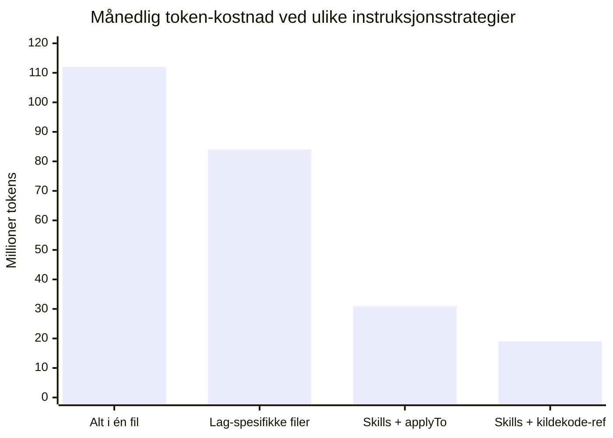
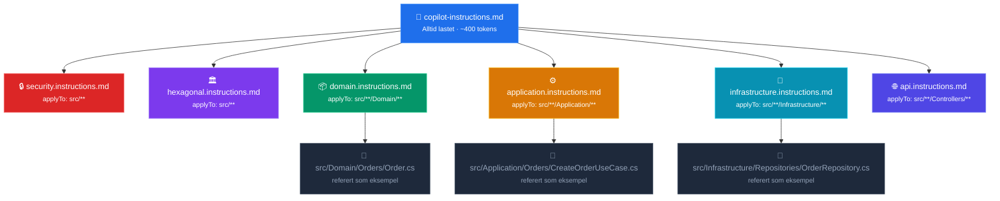
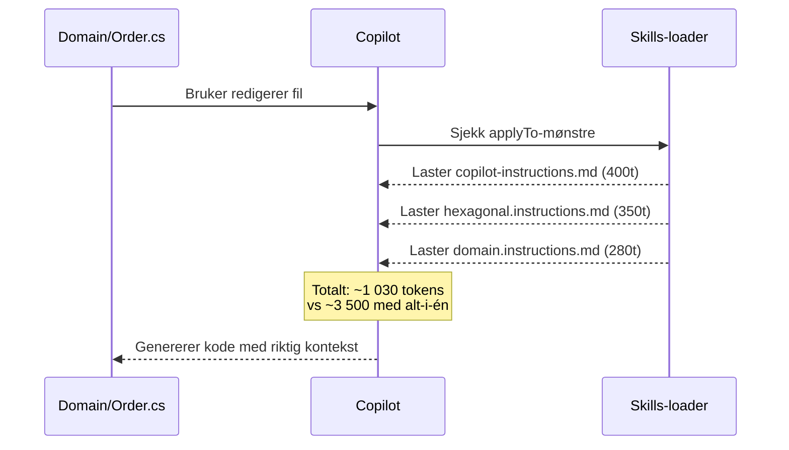
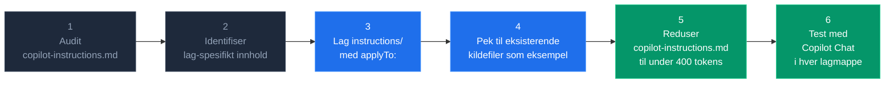

import Tabs from '@theme/Tabs';
import TabItem from '@theme/TabItem';

Alle som jobber med GitHub Copilot i store .NET-prosjekter møter det samme problemet: instruksjonsfilen vokser seg stor, token-kostnadene stiger, og Copilot begynner å ignorere regler som er begravd langt ned i teksten.

Løsningen er ikke å skrive færre regler — det er å strukturere dem smartere. Og hvis prosjektet allerede har en god hexagonal struktur, er den beste templaten du har kildekoden din selv.

{/* truncate */}

## Problemet med én stor instruksjonsfil

Mange starter med å putte alt i `.github/copilot-instructions.md`. Det fungerer til å begynne med, men etter noen måneder ser filen slik ut:

```
# Copilot Instructions

## Security (45 linjer)
## Code Style (38 linjer)  
## Architecture (72 linjer)
## Domain Layer (29 linjer)
## Application Layer (31 linjer)
## Infrastructure Layer (44 linjer)
## Testing (28 linjer)
## API Design (35 linjer)
## Error Handling (22 linjer)
...
```

**Totalt: ~3 500 tokens som lastes på hvert eneste kall** — uansett om du redigerer en domeneklasse, en migrasjon, eller en CSS-fil.

### Token-kostnad eskalerer fort



Overgangen fra «alt i én fil» til Skills med referanser til eksisterende kildekode kan redusere token-bruken med over 80 % — uten at Copilot mister noe kontekstuell kunnskap.

---

## Den riktige arkitekturen: tre nivåer

Prinsippet er enkelt: **last bare det som er relevant for filen du jobber i.**



### Mappestruktur

```
your-project/
├── .github/
│   ├── copilot-instructions.md          ← alltid lastet, hold under 400 tokens
│   └── instructions/
│       ├── security.instructions.md
│       ├── hexagonal.instructions.md
│       ├── domain.instructions.md
│       ├── application.instructions.md
│       ├── infrastructure.instructions.md
│       └── api.instructions.md
├── src/
│   ├── Domain/
│   │   └── Orders/
│   │       └── Order.cs                 ← referert i domain.instructions.md
│   ├── Application/
│   │   └── Orders/
│   │       └── CreateOrderUseCase.cs    ← referert i application.instructions.md
│   └── Infrastructure/
│       └── Repositories/
│           └── OrderRepository.cs       ← referert i infrastructure.instructions.md
└── tests/
```

---

## Hva går i hvert nivå

### Nivå 1: Alltid lastet (`copilot-instructions.md`)

Bare det som gjelder absolutt overalt. Ingen arkitekturstoff her.

```markdown
# [Selskap] — Copilot-regler

## Alltid gjeldende

- Ingen hardkodede secrets, API-nøkler eller passord
- C# nullable reference types aktivert (`<Nullable>enable</Nullable>`)
- Alle public members skal ha XML-dokumentasjon
- Logg aldri passord, tokens eller e-postadresser

## Tilleggsinstruksjoner lastes automatisk

Spesifikke regler for hvert lag lastes via `.github/instructions/`.
Hver skill-fil peker til eksisterende kildekode som referanseeksempel —
følg disse mønstrene ved kodegenerering.
```

**Mål: under 400 tokens.**

---

### Nivå 2: Skills med `applyTo:` glob

`applyTo:`-feltet i frontmatter er nøkkelen. Copilot laster filen kun når aktiv fil matcher.

<Tabs>
  <TabItem value="hexagonal" label="Hexagonal" default>

```markdown
---
applyTo: "src/**"
---
# Hexagonal arkitektur

Prosjektet har allerede veletablerte mønstre — bruk eksisterende kildekode
som referanse fremfor prosa-beskrivelser:
- Aggregate root → `src/Domain/Orders/Order.cs`
- Repository interface → `src/Domain/Orders/IOrderRepository.cs`
- Use case handler → `src/Application/Orders/CreateOrderUseCase.cs`

## Kortregler
- Domain-laget har null avhengigheter til Infrastructure
- Ports er interfaces i Domain, adapters implementerer i Infrastructure
- Use cases orkestrerer — domeneobjekter kaller aldri repo direkte
- Dependency injection settes opp i Infrastructure, aldri i Domain
```

  </TabItem>
  <TabItem value="domain" label="Domain-laget">

```markdown
---
applyTo: "src/**/Domain/**"
---
# Domain-lag

- Kun pure C#, ingen EF Core eller infrastrukturreferanser
- Aggregate roots eksponerer bare metoder, aldri public setters
- Domenefeil via `Result<T>` eller custom exceptions, aldri generiske
- Domain events publiseres fra aggregate root-metoder
- Value objects er immutable og validerer i konstruktøren

## Referanseeksempel
Se `src/Domain/Orders/Order.cs` for kanonisk aggregate root-implementasjon.
```

  </TabItem>
  <TabItem value="application" label="Application-laget">

```markdown
---
applyTo: "src/**/Application/**"
---
# Application-lag

- Use cases er klasser med én public `ExecuteAsync`-metode
- Ingen direkte avhengighet til Infrastructure — kun interfaces fra Domain
- Valider input med FluentValidation før domenekall
- Returner `Result<TResponse>`, aldri kast exceptions mot API-laget
- Én use case = én fil = én ansvarsområde

## Referanseeksempel
Se `src/Application/Orders/CreateOrderUseCase.cs` for kanonisk implementasjon.
```

  </TabItem>
  <TabItem value="infra" label="Infrastructure-laget">

```markdown
---
applyTo: "src/**/Infrastructure/**"
---
# Infrastructure-lag

- EF Core-konfigurasjoner i separate `IEntityTypeConfiguration<T>`-klasser
- Repositories implementerer interfaces definert i Domain
- Ingen domenlogikk i repositories — kun datahenting og persistering
- Migrations auto-genereres, aldri skrives for hånd
- Connection strings og secrets hentes fra `IConfiguration`, aldri hardkodet

## Referanseeksempler
- Repository: `src/Infrastructure/Repositories/OrderRepository.cs`
- EF-konfigurasjon: `src/Infrastructure/Persistence/Configurations/OrderConfiguration.cs`
```

  </TabItem>
</Tabs>

---

### Nivå 3: Kildekoden er templaten

I et prosjekt med god hexagonal struktur er den viktigste innsikten denne:

> **Pek Copilot til eksisterende kode — ikke skriv prosa som forklarer hva koden skal gjøre.**

En referanse til `src/Domain/Orders/Order.cs` gir Copilot direkte tilgang til faktisk implementasjon. Koden er alltid oppdatert, presis, og koster færre tokens enn en tilsvarende prosa-forklaring.

```markdown title="Sammenligning: prosa vs. kilereferanse"
# ❌ Prosa (dyrt og upresist)
Aggregate roots skal ha private konstruktør, bruke factory methods,
eksponere kun metoder (ikke setters), publisere domain events via
AddDomainEvent(), og returnere Result<T> fra alle muterende operasjoner...

# ✅ Referanse (billig og presis)
Se src/Domain/Orders/Order.cs for kanonisk aggregate root-implementasjon.
```

**Når er separate template-filer likevel nyttig?**

- Prosjektet er helt nytt og har ingen eksempler ennå
- Et mønster brukes sjelden og eksempler er vanskelig å finne i kodebasen
- Du vil tvinge en spesifikk struktur som bevisst avviker fra eksisterende kode

I alle andre tilfeller: bruk kildekoden direkte.

---

## Token-regnestykket

Her er hva du faktisk betaler per kall avhengig av hvilken fil du redigerer:



| Scenario | Tokens lastet | Besparelse |
|---|---|---|
| Alt i `copilot-instructions.md` | ~3 500 alltid | — |
| Redigerer `Domain/Order.cs` | ~1 030 | 71 % |
| Redigerer `Infrastructure/Repo.cs` | ~1 080 | 69 % |
| Redigerer `Controllers/OrdersController.cs` | ~1 120 | 68 % |
| Redigerer `appsettings.json` | ~400 | 89 % |

Ved 1 000 Copilot-kall per dag sparer dette tilsvarende **2,5 millioner tokens daglig** — bare ved å flytte instruksjoner fra én fil til Skills med riktig glob.

---

## Implementer det steg for steg



### Steg 1: Audit eksisterende fil

Åpne `copilot-instructions.md` og merk hvert avsnitt med ett av disse:

- 🔴 **Alltid** — sikkerhet, basiskonvensjoner
- 🟡 **Lag-spesifikt** — flyttes til instructions/
- 🟢 **Mønsterbeskrivelse** — erstattes med referanse til eksisterende kildefil

### Steg 2: Test at `applyTo:` virker

```bash
# Åpne en fil i Domain-laget og sjekk Copilot Chat
# Spør: "Hvilke instruksjoner gjelder for denne filen?"
# Copilot skal liste opp riktige skills, ikke alle
```

### Steg 3: Hold referansene oppdatert

Når teamet refaktorerer et mønster, oppdater referansen i skill-filen hvis filstien endrer seg. Koden selv holder seg alltid oppdatert — det er en av fordelene med å peke til eksisterende kildekode fremfor dupliserte template-filer.

---

## Oppsummering

Det finnes én regel som styrer resten:

> **Pek Copilot til eksisterende kode — ikke skriv prosa som forklarer hva koden skal gjøre.**

Copilot er trent på kode. Den lærer mønstre fra eksempler raskere og mer presist enn fra prosa — og en referanse til en eksisterende kildefil koster nesten ingen tokens, er alltid oppdatert, og kan ikke bli utdatert på samme måte som en separat template-fil.

Kombiner det med `applyTo:`-globbing og du har et system som skalerer med prosjektet ditt uten at token-kostnaden gjør det samme.

---

:::tip Kom i gang med én gang
Begynn med bare tre filer: `copilot-instructions.md` (under 400 tokens), `hexagonal.instructions.md` med `applyTo: "src/**"`, og pek til én eksisterende aggregate root i kodebasen din. Det gir umiddelbar effekt og er enkelt å bygge videre på.
:::

:::info Vil du se et komplett eksempel?
Det fullstendige oppsettet med alle instructions-filer og en `validate-copilot-config.sh`-skript ligger i [GitHub-repoet](https://github.com/example/copilot-hexagonal-dotnet).
:::
